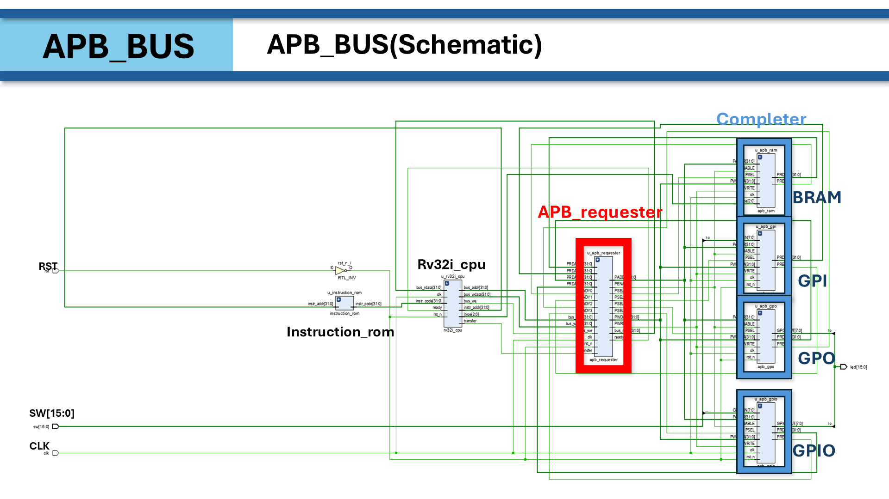

# AI System Semiconductor — FPGA Design & Verification

Basys-3(Xilinx Artix-7) FPGA를 대상으로 한 **Verilog RTL 설계**와
**SystemVerilog / UVM 기반 검증**, **RISC-V CPU 설계** 기록입니다. (2026.07 ~ 2026.09)

| 구분 | 사용 도구 |
|---|---|
| 언어 | Verilog HDL, SystemVerilog |
| 보드 | Digilent Basys-3 (XC7A35T, 100 MHz) |
| 합성 / 시뮬레이션 | Vivado (xsim) |
| 검증 | Synopsys VCS + Verdi, UVM 1.2, Verilator |

---

## 📂 VerilogHDL

| 프로젝트 | 내용 | 핵심 키워드 |
|---|---|---|
| [UART_Stopwatch_Watch](VerilogHDL/UART_Stopwatch_Watch) | 시계/스톱워치에 UART 명령 제어 통합 | UART RX/TX FSM, ASCII 디코더, **TB race condition 분석** |
| [UART_FIFO_Loopback](VerilogHDL/UART_FIFO_Loopback) | FIFO 설계·검증 후 UART와 연결한 루프백 | FIFO full/empty, ptr 제어, self-checking TB |
| [Sensor_Smartwatch_MiniProject](VerilogHDL/Sensor_Smartwatch_MiniProject) | 시계 + 스톱워치 + 초음파(SR-04) + 온습도(DHT11) 통합 | 센서 프로토콜, UART 문자열 명령, FND 출력 |

## 📂 SystemVerilogHDL

| 프로젝트 | 내용 | 핵심 키워드 |
|---|---|---|
| [UVM_Verification](SystemVerilogHDL/UVM_Verification) | Adder / Counter / RAM / FIFO UVM 테스트벤치 | sequence-driver-monitor-scoreboard, VCS/Verdi |
| [RV32I_SingleCycle](SystemVerilogHDL/RV32I_SingleCycle) | RV32I 싱글사이클 CPU (R/S-type) | datapath, control unit, Harvard 구조 |
| [RV32I_MultiCycle_APB](SystemVerilogHDL/RV32I_MultiCycle_APB) | **팀 프로젝트** — 멀티사이클 RV32I CPU + APB 버스 | 멀티사이클 FSM, APB RAM/GPI/GPO/GPIO, AI 기반 엣지 케이스 검증 |

---

## 하이라이트



- **RV32I Multi-Cycle CPU + APB** — 100 MHz에서 positive slack(WNS +1.676 ns) 달성,
  누적합(0~10 → 55) 프로그램 정상 동작, AI 에이전트 검증으로 결함 8건 수정(엣지 케이스 14/15 PASS)
- **FIFO UVM** — 레퍼런스 모델 기반 scoreboard로 DUT의 리셋 시 `empty` 초기값 버그 발견·수정
- **UART + Stopwatch** — 테스트벤치에서 `#delay`와 `@(posedge clk)`가 같은 시각에 겹쳐 생기는
  race condition을 원인 분석하고 해결

## 폴더 공통 구조

```
<Project>/
├── README.md          프로젝트 설명 (발표 내용 정리)
├── images/            README에 쓰인 블록도·파형 캡처
├── <name>.xpr         Vivado 프로젝트 (열면 소스 자동 연결)
└── <name>.srcs/
    ├── sources_1/     설계 RTL
    ├── sim_1/         테스트벤치
    └── constrs_1/     Basys-3 핀 제약 (.xdc)
```

> Vivado 생성물(`.runs`, `.cache`, `.sim` 등)은 올리지 않았습니다. `.xpr`을 연 뒤 합성/시뮬레이션을 다시 실행하면 됩니다.
