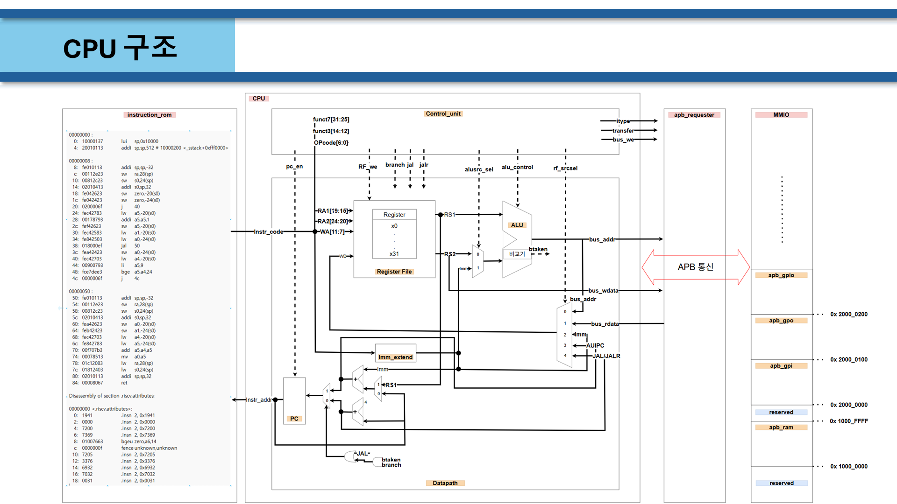
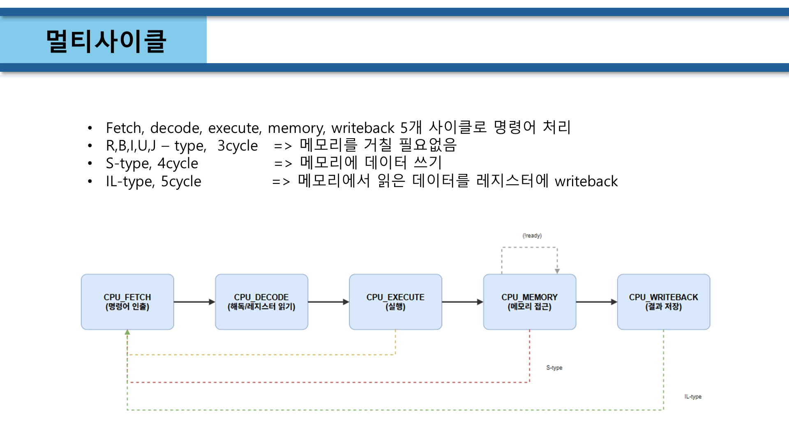
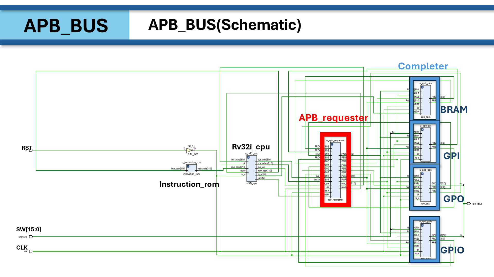
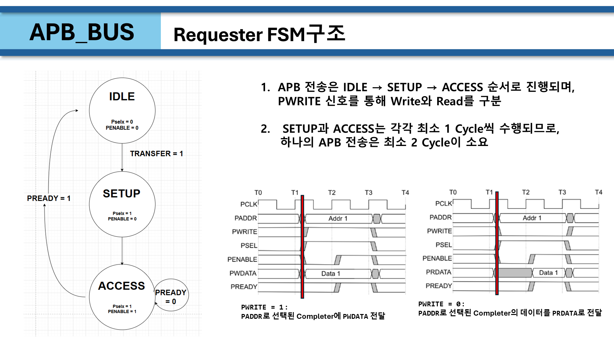
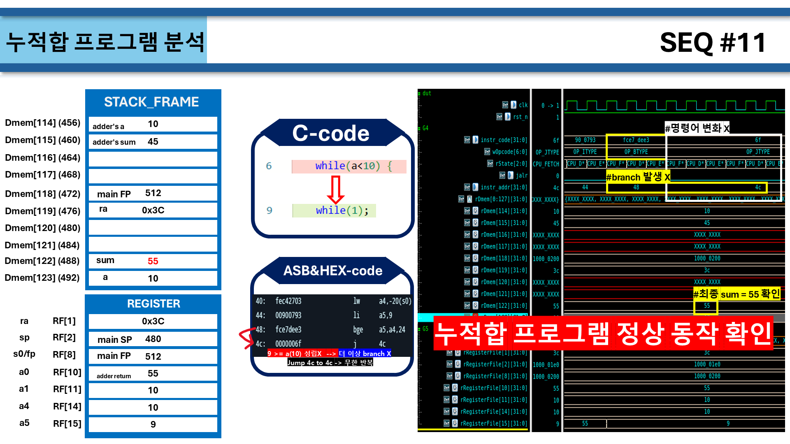
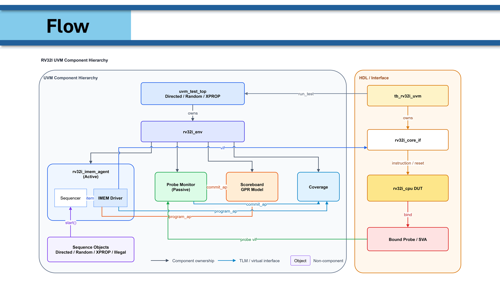
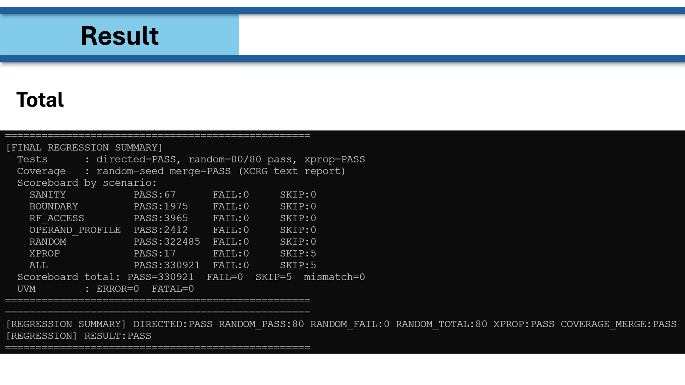
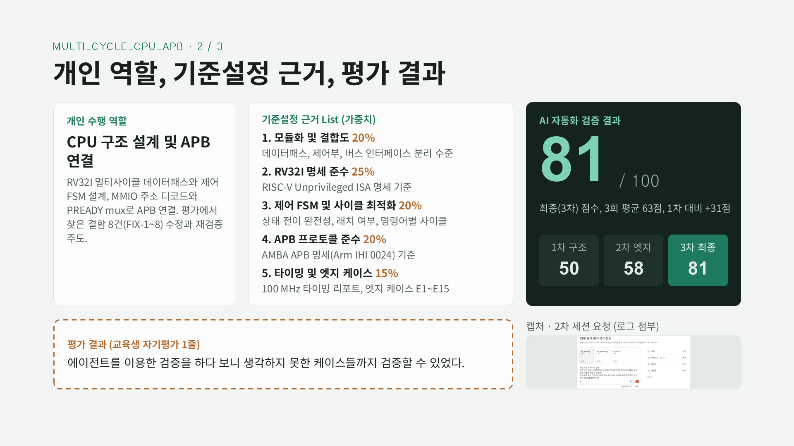
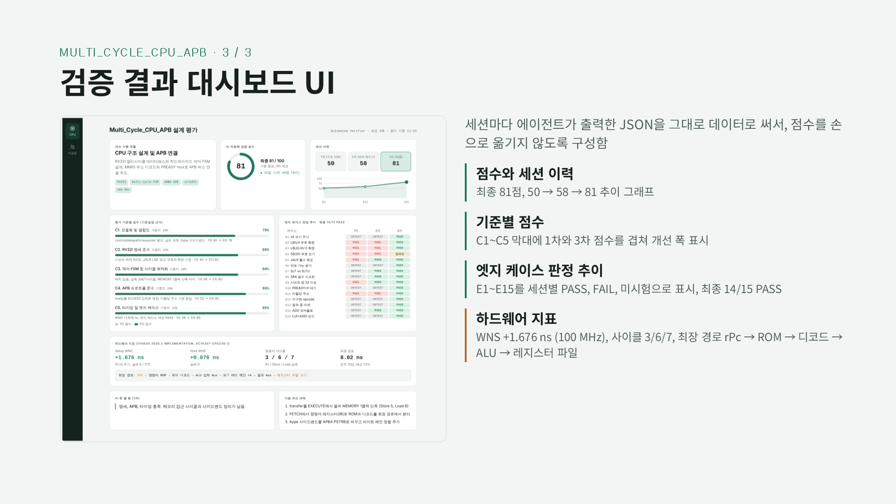

# RV32I Multi-Cycle CPU + APB Bus (팀 프로젝트)

RISC-V RV32I 멀티사이클 CPU와 AMBA APB 버스를 설계하고, RAM·GPI·GPO·GPIO 주변장치를 연결해
Basys-3 보드에서 동작을 확인한 4인 팀 프로젝트입니다. (2026.09)

| 담당 | 내용 |
|---|---|
| 이기광 | **CPU 구조 & 명령어**, APB 연결, AI 검증 및 결함 수정 |
| 홍세헌 | APB 프로토콜 |
| 정용호 | 파형 기반 CPU 동작 검증 |
| 한대규 | CPU R/I-type UVM 검증 |

| 폴더 | 내용 |
|---|---|
| `team_final.srcs/` | 팀 최종 제출본 |
| `ai_verified.srcs/` | AI 에이전트 검증으로 찾은 결함 8건(FIX-1~8)을 수정한 버전 + 검증 로그(`reports/`) |

## CPU 스펙

| 항목 | 내용 |
|---|---|
| ISA | RISC-V RV32I |
| 처리 방식 | Multi-cycle (FETCH → DECODE → EXECUTE → MEM → WB) |
| 레지스터 파일 | 32-bit × 32 |
| 메모리 | Harvard 구조 (instruction ROM / APB 위의 data RAM) |
| 클럭 | 100 MHz, WNS +1.676 ns |

싱글사이클 구조에서 타이밍 위반(10.31 ns)이 발생해 멀티사이클로 전환했습니다.





| 명령어 타입 | 단계 | 측정 사이클 |
|---|---|---|
| R / I / B / U / J | 메모리 접근 없음 | 3 |
| S (store) | + MEM (APB write) | 6 |
| IL (load) | + MEM + WB (APB read) | 7 |

## APB 버스

```
rv32i_cpu ──▶ APB Requester ──PSEL0..6──▶ BRAM (0x1000_0000)
   ▲              │ IDLE → SETUP → ACCESS    GPI  (0x2000_0000)  ◀── SW
   └── ready ◀────┘ (PREADY mux)             GPO  (0x2000_0100)  ──▶ LED
                                              GPIO (0x2000_0200)  ◀─▶ SW / LED
```

- CPU 수정 없이 속도·개수가 다른 주변장치를 표준 인터페이스 하나로 연결
- `PWRITE`로 write/read 구분, SETUP·ACCESS 각 최소 1 cycle → 전송당 최소 2 cycle
- Completer의 `PREADY`가 올라올 때 `PRDATA`를 CPU로 전달 (느린 슬레이브 대기 지원)
- GPIO 예: CTR(0x2000_0200)에 0xFF, ODR(0x2000_0204)에 0x55 write → IDR(0x2000_0208) read





## 검증

**1. 누적합 프로그램 (C → Assembly → ROM)**
- 스택 프레임, `jal`/`jr ra` 함수 호출, `bge` 분기를 레지스터·메모리 단위로 추적
- 0~10 누적합 최종 `sum = 55` 확인



**2. UVM (R/I-type 19개 명령어)**
- 독립 reference scoreboard + bind SVA (FSM 전이, x0 규칙, PC+4, data-bus 접근 금지 등)
- 시나리오: 경계값, x0~x31 alias/의존성(RAW, gap 0~3), 9개 대표값 조합, 랜덤 1000, X 전파·illegal encoding
- 80 seed에서 목표 coverage 달성





**3. AI 에이전트 기반 엣지 케이스 검증** (`ai_verified.srcs/reports/`)
- RV32I·APB 명세와 설계 문서를 지식으로 주고, 채점 기준(모듈화 / ISA 준수 / FSM / APB / 타이밍·엣지 케이스)을 고정해 평가
- 엣지 케이스 E1~E15 (x0 쓰기, 부호/0 확장 load, SRA/shamt 마스킹, 미할당 주소, 리셋 중 동작, 느린 슬레이브 등)
- 결함 8건 수정 → 점수 50 → 58 → **81**, 엣지 케이스 **14/15 PASS**
- Verilator 회귀: 시스템 18 PASS, 유닛 12 PASS, APB wait-state 3 PASS





## 고찰

- Critical path(`PC → ROM → decode → ALU → register file`) 최적화가 부족해 setup slack margin이 1.7%에 그침
- 코너 케이스가 많아 효율적인 cross coverage 설계가 중요함을 확인
