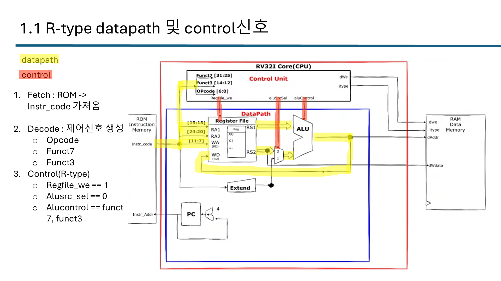
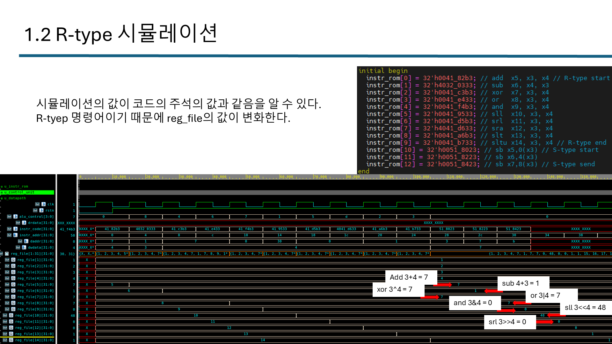
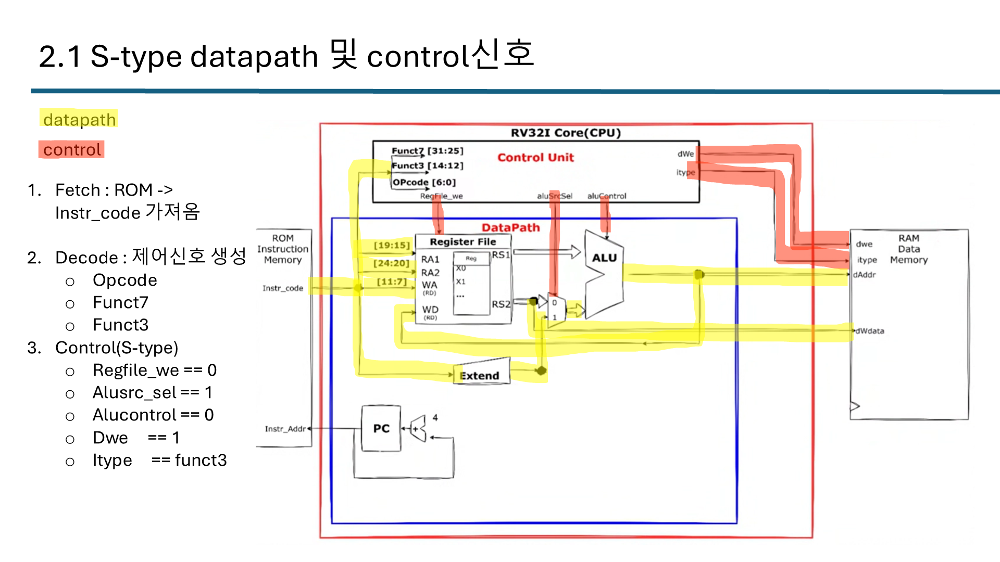

# RV32I Single-Cycle CPU

RISC-V RV32I 싱글사이클 CPU입니다. R-type과 S-type 명령어의 datapath·제어 신호를 구현하고 시뮬레이션으로 확인했습니다.
이후 [RV32I_MultiCycle_APB](../RV32I_MultiCycle_APB) 프로젝트의 기반이 됩니다.

## 구성

| 파일 | 역할 |
|---|---|
| `rv32i_cpu.sv` | Top (control unit + datapath) |
| `control_unit.sv` | opcode / funct3 / funct7 디코드 → 제어 신호 |
| `datapath.sv` | PC, register file(32×32), ALU, immediate 생성 |
| `instruction_rom.sv` / `data_memory.sv` | Harvard 구조 명령어 ROM / 데이터 RAM |
| `pkg/rv32i_pkg.sv` | opcode, ALU 연산 정의 |

## R-type (opcode `0110011`)

- `rs1`, `rs2`를 연산해 `rd`에 저장, `{funct7, funct3}` 조합으로 연산 결정
- 제어: `regfile_we = 1`, `alusrc_sel = 0`, `alucontrol = {funct7, funct3}`
- 검증 (x3 = 3, x4 = 4, `instruction_rom.sv`에 명령어 직접 기입): `add`=7, `sub`(x4−x3)=1, `xor`=7, `or`=7, `and`=0, `sll`=48, `srl`=0

## S-type (opcode `0100011`)

- `rs1 + imm` 주소의 데이터 메모리에 `rs2` 저장, `imm = {[31:25], [11:7]}` 12bit
- 제어: `regfile_we = 0`, `alusrc_sel = 1`, `dwe = 1`, `itype = funct3`

- 검증: `SB` / `SH` / `SW`로 x5(=7)를 `dmem[0/4/8 + x3]`에 바이트·하프워드·워드 단위로 저장 확인
