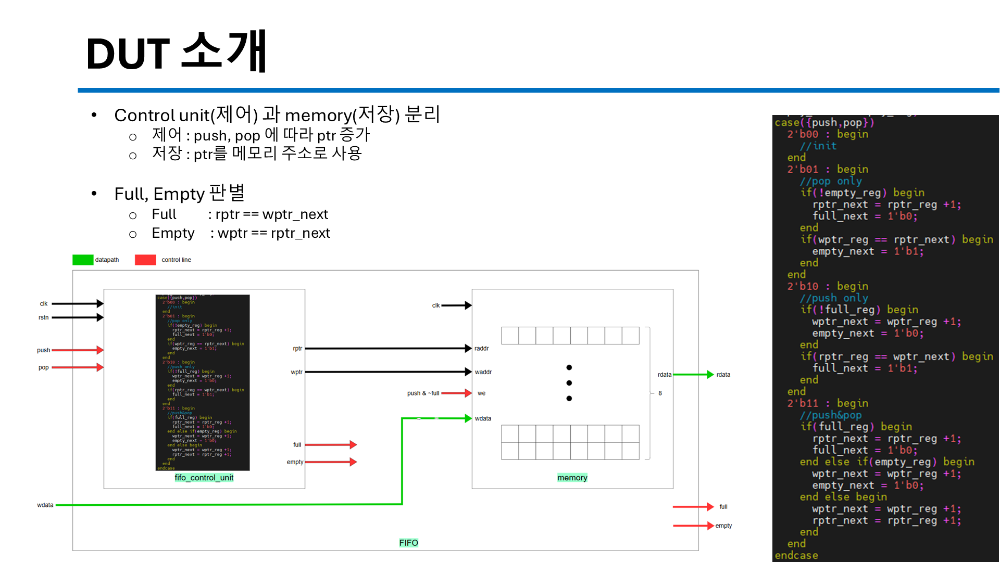
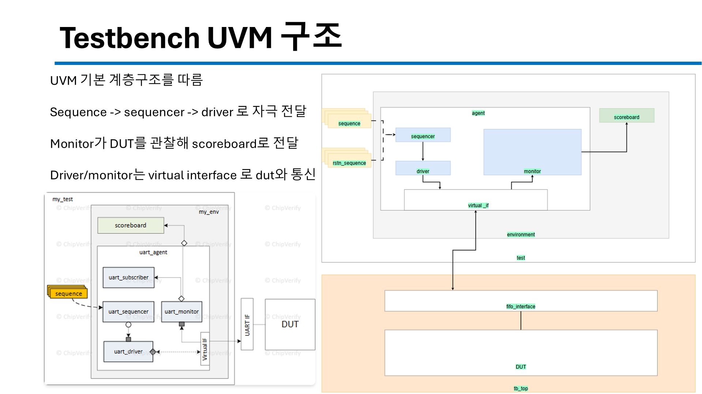
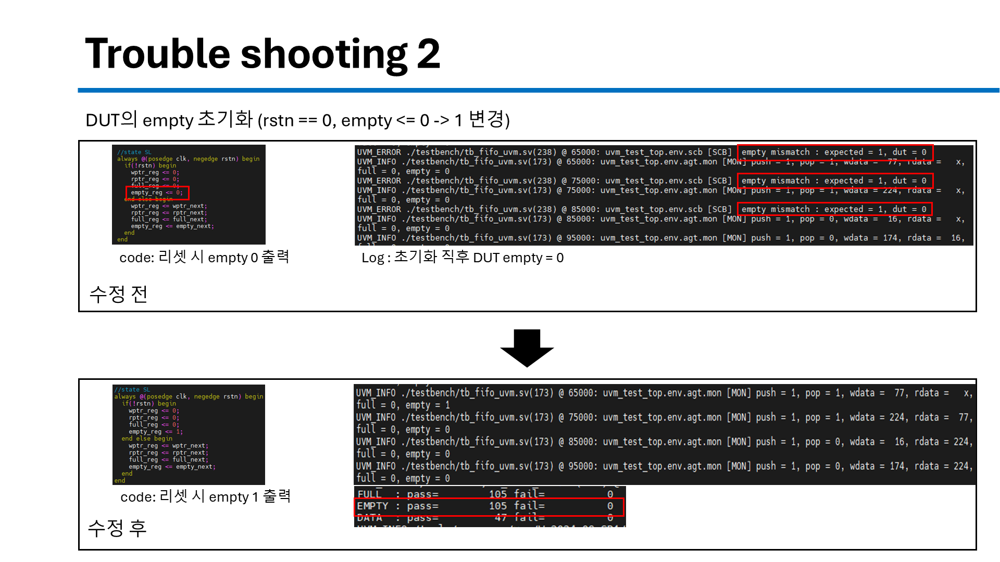

# UVM Verification

Synopsys VCS + Verdi 환경에서 UVM 1.2로 작성한 테스트벤치 모음입니다. DUT가 단순한 것부터 FIFO까지 단계적으로 진행했습니다.

| 폴더 | DUT | 테스트벤치 |
|---|---|---|
| `0826_adder_uvm` | Adder | `tb_adder_uvm.sv` |
| `0826_counter_uvm` | Counter | `tb_counter_uvm.sv` |
| `0829_ram_uvm` | RAM | `tb_ram_uvm.sv` |
| `0831_fifo_uvm` | FIFO (depth 8) | `tb_fifo_uvm.sv` |

## 실행

```bash
cd 0831_fifo_uvm
make run     # vcs -full64 -sverilog -ntb_opts uvm-1.2 (+ line/cond/fsm/tgl/branch coverage)
make simv    # 시뮬레이션 (+UVM_VERBOSITY=UVM_HIGH)
make verdi   # 파형 확인
```

## FIFO UVM 검증

**왜 UVM인가** — 설계자마다 제각각인 TB 구조·통신 방식을 표준화해서, 검증 컴포넌트를 재사용하고
엔지니어가 인프라 대신 stimulus와 scoreboard에 집중할 수 있게 하기 위함.

**DUT** — control unit(포인터 제어)과 memory(저장) 분리, depth 8



**구조**

```
sequence ─▶ sequencer ─▶ driver ──vif──▶ DUT ──vif──▶ monitor ─▶ scoreboard (reference model)
```



**Scoreboard 모델링**
- full/empty 판별을 push/pop 반영보다 먼저 처리 (순차 실행이라 모델 포인터가 먼저 바뀌는 것 방지)
- 모델의 push/pop이 DUT와 같은 타이밍에 처리되도록 DUT 기준으로 동작
- full / empty / data 항목별로 PASS/FAIL을 나눠서 어디서 틀렸는지 바로 구분

**시나리오**: Reset 5회 + randomize(push, pop, wdata) 100회

## Trouble Shooting

| # | 현상 | 원인 | 수정 |
|---|---|---|---|
| 1 | 모델이 DUT보다 full을 먼저 판단 | 모델 full 기준 `count == 7` | `count == 8` 로 수정 (모델 버그) |
| 2 | 리셋 직후 DUT `empty = 0` | DUT 리셋 시 `empty <= 0` | `empty <= 1` 로 수정 (**DUT 버그 발견**) |



## 개선할 점

- 현재는 depth 8 한 가지만 검증 → 메모리 크기를 파라미터화해 여러 depth 검증
- functional coverage 기반으로 검증 완료 기준 확장
