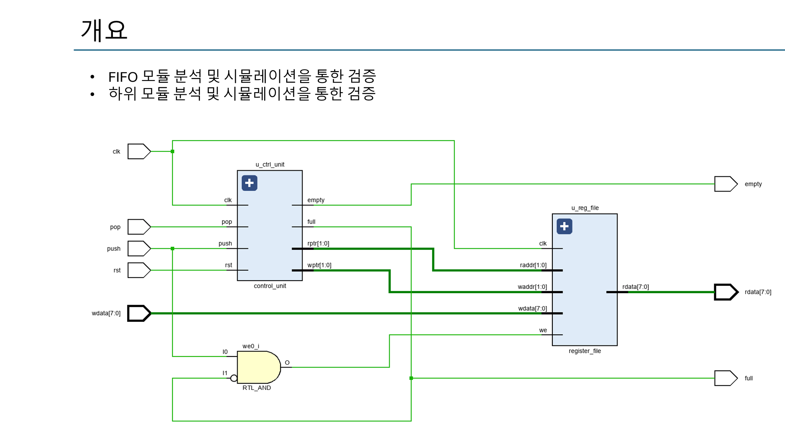
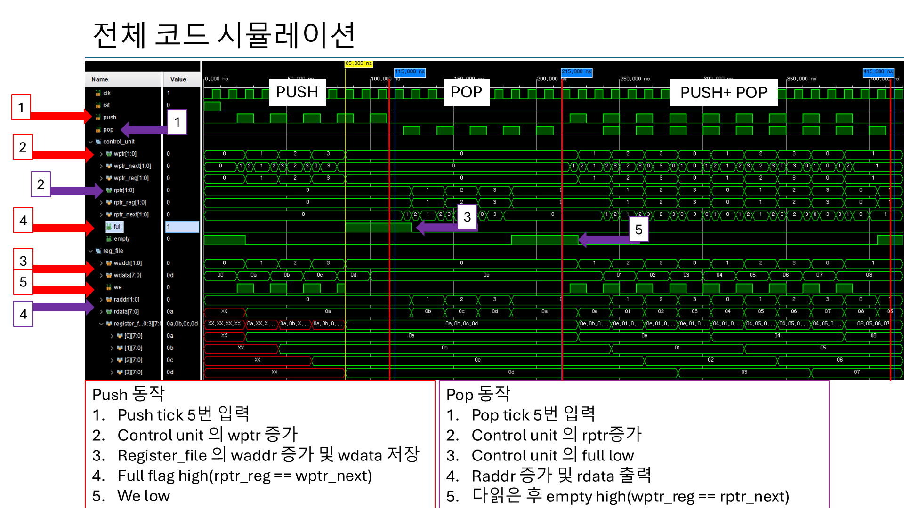
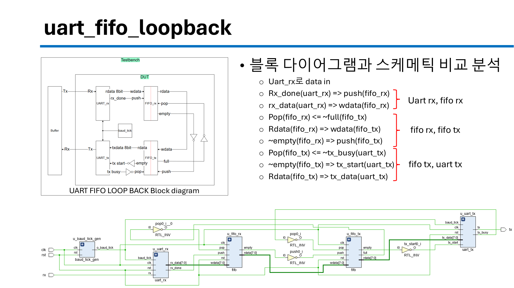
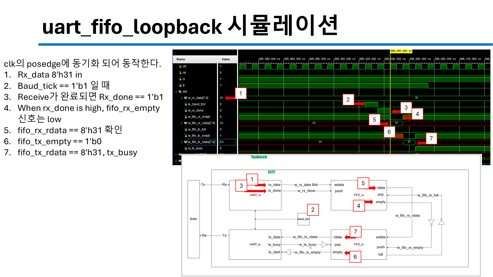

# FIFO & UART-FIFO Loopback

FIFO를 설계하고 self-checking 테스트벤치로 검증한 뒤, UART RX/TX 사이에 FIFO 2개를 넣어 루프백을 구성했습니다.

| 폴더 | 내용 |
|---|---|
| `fifo/` | FIFO (control unit + register file) 및 `tb_fifo.v` |
| `uart_fifo_loopback/` | `uart_rx → fifo_rx → fifo_tx → uart_tx` 루프백 및 `tb_uart_fifo_loopback.v` |

## FIFO 구조

- **Control unit**: `push`/`pop`에 따라 `wptr`/`rptr` 증가, full/empty 판정
  - Full : `wptr_next == rptr`
  - Empty : `rptr_next == wptr`
- **Register file**: 포인터를 주소로 사용해 쓰기/읽기, full이면 `we` 차단
- push + pop 동시 입력 시 `waddr`/`raddr` 동시 증가





## UART-FIFO 루프백 연결

```
uart_rx ──rx_done──▶ push ┐                         ┌ pop ◀── ~tx_busy
        ──rx_data──▶ wdata│ fifo_rx ──rdata──▶ wdata│ fifo_tx ──rdata──▶ uart_tx
                          └ pop ◀── ~full(fifo_tx)  └ push ◀── ~empty(fifo_rx)
                                                       ~empty(fifo_tx) ──▶ tx_start
```





## 검증 방법 (self-checking TB)

- **Drive 블록**: `posedge clk` 후 1 ns 뒤에 랜덤 push/pop/wdata 구동 → DUT 순차회로와 같은 time slot에서 겹치지 않게 함
- **Monitor & score 블록**: `negedge clk`에서 `compare_buffer`(예측 큐)와 실제 `rdata`, full/empty 플래그 비교
- 루프백: `8'h31` 수신 → `fifo_rx` → `fifo_tx` → `uart_tx`로 다시 송신되는 것을 파형으로 확인

## Trouble Shooting

| | |
|---|---|
| 증상 | full이 올라왔는데도 `wptr`이 계속 움직임 (empty일 때 `rptr`도 동일) |
| 원인 | full/empty 상태에서 포인터 증가를 막는 조건이 없음 |
| 해결 | full이 아닐 때만 `wptr`, empty가 아닐 때만 `rptr`이 증가하도록 수정 |
