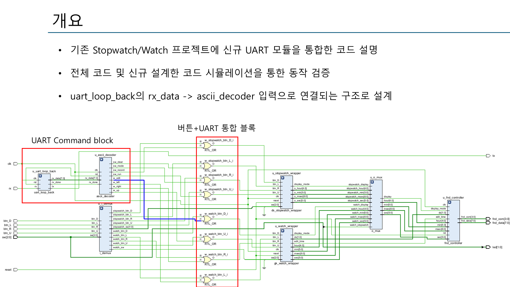
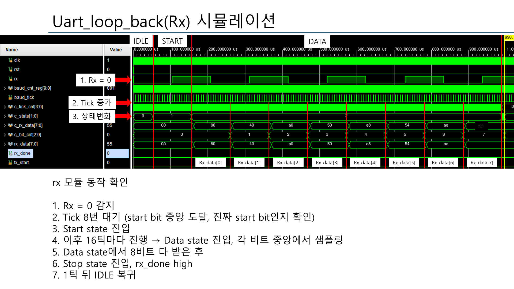
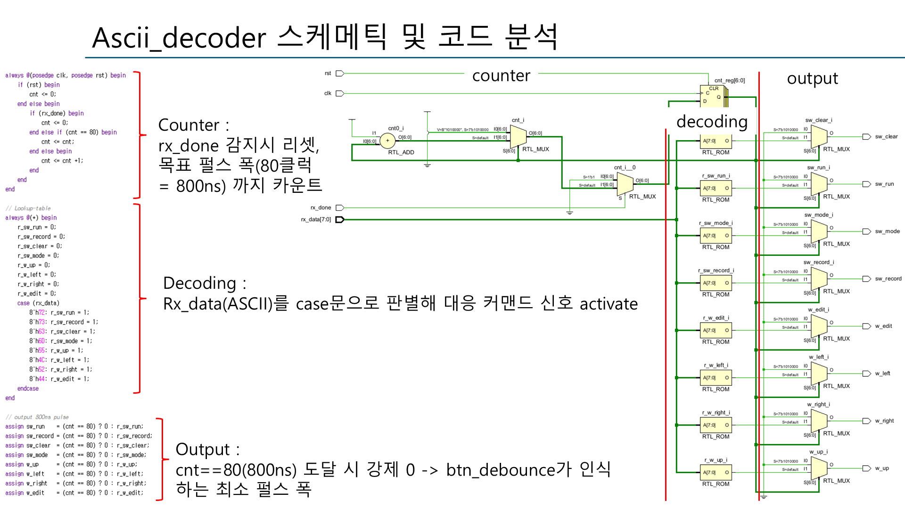
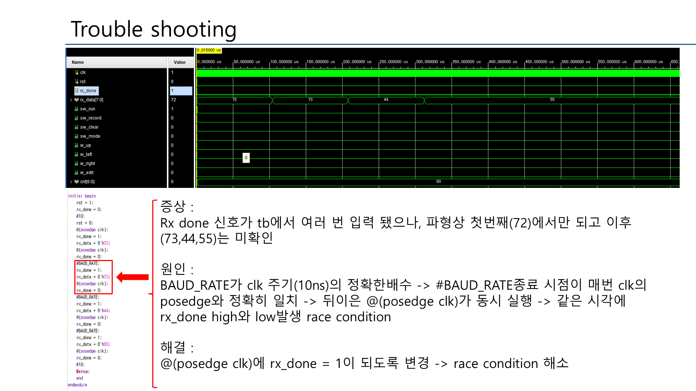

# UART + Stopwatch / Watch

기존 시계·스톱워치 프로젝트에 UART 모듈을 통합해, 버튼뿐 아니라 **PC에서 보낸 문자로도 제어**할 수 있게 만든 프로젝트입니다.

## 구조

```
rx ─▶ uart_rx ─▶ rx_data ─▶ ascii_decoder ─▶ (sw_run / sw_record / w_edit ...) ─┐
          │                                                                       ├─▶ control_unit ─▶ stopwatch / watch ─▶ FND
          └─▶ uart_tx ─▶ tx   (loopback)                  버튼 ─▶ btn_debounce ─┘
```



| 모듈 | 역할 |
|---|---|
| `uart.v`, `uart_loop_back.v` | Baud rate·클럭 파라미터화, 16× oversampling RX/TX FSM, 수신 데이터를 TX로 에코 |
| `ascii_decoder` (`uart.v` 내부) | 수신 ASCII를 `case`로 판별해 명령 신호 생성 (`r`(0x72) = run, `s`(0x73) = record, `D`(0x44) = edit ...) |
| `stopwatch.v`, `watch_wrapper.v`, `sw_w.v` | 스톱워치 / 시계 로직과 모드 전환 |
| `btn_debounce.v`, `fnd_controller.v` | 버튼 디바운스, 7-segment 스캔 출력 |

## 동작 / 검증 포인트

- **UART RX**: `rx=0` 감지 → 8 tick 대기(start bit 중앙 확인) → 16 tick마다 각 비트 중앙에서 샘플링 → stop에서 `rx_done`
- **UART TX**: `rx_done` → `tx_start` → START/DATA(LSB first)/STOP → `tx_done`
- **ASCII 디코더**: 명령 펄스를 80 clk(800 ns) 동안 유지 → `btn_debounce`가 인식하는 최소 펄스 폭 확보
- **Top 시뮬레이션**: 스위치로 스톱워치 모드 + UART로 `0x44` 입력 → 시계 edit 모드 진입까지 확인





## Trouble Shooting — 테스트벤치 race condition

| | |
|---|---|
| 증상 | TB에서 `rx_done`을 여러 번 줬는데 첫 번째(0x72)만 반영되고 이후(0x73, 0x44, 0x55)는 무시됨 |
| 원인 | `BAUD_RATE` 지연이 clk 주기(10 ns)의 정확한 배수 → `#BAUD_RATE` 종료 시점과 `@(posedge clk)`가 같은 시각 → `rx_done` high/low가 같은 time slot에서 발생 |
| 확인 | `$display`로 high/low 시점을 찍어 둘 다 104,185,000 ns임을 확인 |
| 해결 | `rx_done = 1`을 `@(posedge clk)`에 맞춰 구동하도록 변경 |



> 시간 기반 지연(`#`)과 이벤트 기반 제어(`@`)를 섞어 쓸 때는 두 시점이 겹치지 않도록 해야 한다.

## 파일

- `2026_0728_stopwatch.xpr` — Vivado 프로젝트 (스톱워치 프로젝트를 이어서 작업해서 이름이 이렇습니다)
- `2026_0728_stopwatch.srcs/sim_1/new/` — `tb_uart_loop_back.v`, `tb_ascii_decoder.v`, `tb_sw_w_uart.v`, `tb_top.v`
